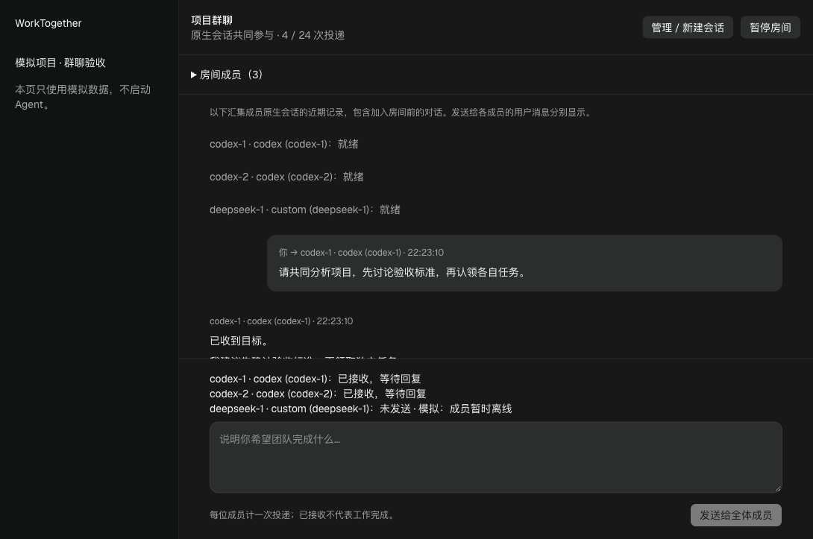
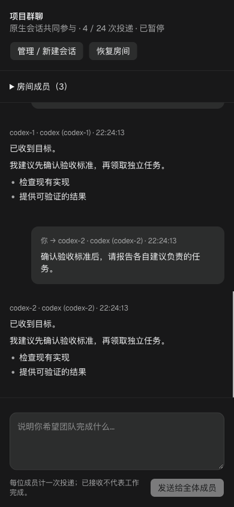
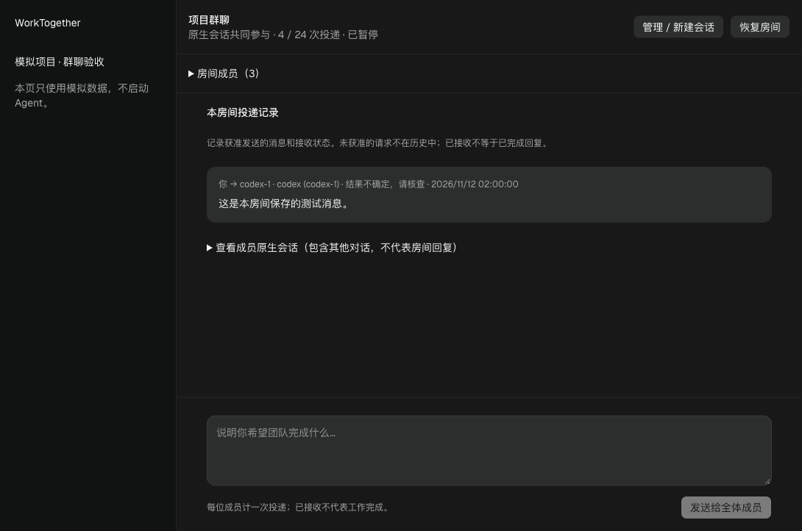

# Agent Orchestrator 原生客户端验证

日期：2026-11-11。版本：官方 macOS arm64 v0.14.10。

## 决策
继续以 AO 为原生执行底座候选，暂不迁移真实项目。原版终端发送被拒的问题已通过独立实验分支的受限 MCP 工具解决，真实通信及双 Codex 独立写入已验证；自主认领、群聊预算和生产边界尚待完善。不得以跳过权限代替修复。

## 环境与证据
- 应用位于 `~/Applications/worktogether-evaluation/Agent Orchestrator.app`；codesign --verify --deep --strict 通过。
- AO_DATA_DIR 与 AO_RUN_FILE 都指向独立 evaluation 目录；未替换现有 WorkTogether 数据库。
- Codex login status 返回 Logged in using ChatGPT；没有新增 API Key。
- DeepSeek 使用现有应用内部 dsh，加入的 PATH 仅用于本次后台进程；AO 探测 authorized。其实际账户计费来源未独立核实。
- 独立空 Git 项目 wt-probe，使用本地 bare remote；没有上传或发布。无 remote 时 AO 返回 DEFAULT_BRANCH_UNRESOLVED，补本地默认分支后通过。
- wt-probe-1 / wt-probe-2：两个 Codex 原生会话，provider conversation ID 不同，工作目录不同；分别返回 READY-CODEX-1 / READY。
- wt-probe-3：DeepSeek Harness 原生 ACP 会话，返回 READY。
- 通过 AO send 要求 Codex-1 向 DeepSeek 发送一次测试消息。Codex 实际尝试后报告：连接 127.0.0.1:3001 被拒绝，operation not permitted。接收会话未出现 PEER-ACK-731。未重放、未放宽权限。
- 原始消息与会话记录保留在 evaluation/data/ao.db；不提交账号或原始数据库。
- AO 注入的系统说明约 16 KB，短消息也有上下文开销；尚无节省额度结论。

## 已验证与未验证
已验证：安装签名、原生客户端发现、三个独立会话实际回复、不同工作目录。
截至本轮：同伴通信、原生任务认领与独立目录写入已验证；候选 Git 集成有真实 Git 自动测试。仍未验证完整自动群聊、端到端自动交付、桌面群聊 UI、其它项目完整无干扰及成本收益。
工作目录隔离不等于操作系统隔离；账号额度仍共享。

## 下一步
1. 对照当前版本源码检查 Codex app-server 的权限配置与 AO 消息传递入口。优先使用受支持的消息工具或仅针对本地 AO 服务的授权；不得启用全局 bypass。
2. 通道解决后重做一次有发送者身份的 Codex → DeepSeek 消息测试；保留明确停止条件。
3. 再验证两位 Codex 在独立工作目录各改一个小文件，以及第三成员的验收和集成。
4. 上述通过才比较 AO 原版与群聊目标的差距，决定直接使用或 fork；不同时维护两套执行调度器。

## 回归验证
本轮仅新增评估文档；后端 388 项、前端 18 项、生产构建均通过。构建未产生仓库差异。真实 Agent 只执行了连通与一次同伴发送探测，实际消耗未量化。

## 第二轮：受限原生工具通道与实际写入

- 源码固定于上游 v0.14.10 / `033d597032e448a0ea16c298350e36b099f74106`，独立目录 `~/Applications/worktogether-evaluation/source`，分支 `codex/scoped-peer-mcp`。
- 实验提交 `775460d`；补丁随本文保存在 `experiments/ao-scoped-peer-mcp.patch`。尚未发布上游 PR，也未替换签名应用。
- 根因：accept-edits 模式的 Codex 终端无网络；原生 ao MCP 本身在工具进程中可以访问后台，但只提供展示/电脑操作工具，未提供同伴发送。
- 补充 peer_send MCP 工具，默认关闭，仅后台环境 AO_PEER_PROJECT 明确启用的项目可用。发送者来自工具启动环境，不接受模型传入；双方须为该项目未终止成员；拒绝自发、空内容、超过 2000 字节和未知字段。复用现有 daemon 发送接口，不启动 shell，不改变 Codex 权限。
- 实测：Codex 调用 peer_send，DeepSeek 消息记录 sender_session_id=wt-probe-1，收到原文并返回 PEER-ACK-942；Codex 返回 PEER-SENT-942。
- 两个 Codex 分别实际创建 alpha.txt / beta.txt，内容与换行精确匹配；各自目录不存在另一文件，原始 probe 仓库不含它们。两个任务重叠派发，但未测量实际写入是否同一时刻。
- 集成人将两个已核对产物复制到 DeepSeek 自己的工作目录，DeepSeek 读取并实际检查字节后返回 PASS-942。此处是人工/协调程序集成，不是自动 Git 合并或自主认领的证明。
- CLI 完整测试、MCP/peer 专项测试和源码构建通过。session_manager 首轮因测试环境缺少 tmux 失败，指定附带 tmux 后仍有 4 项 spawn 前置环境测试失败（缺失程序测试与 tmux 探测顺序相互影响）；上游 session_manager 全包未通过，不宣称全套 CI 通过。

### 仍然必须补齐的生产边界

当前补丁仅为隔离实验，不能直接用于真实项目团队：项目级发送范围尚不等于房间级成员授权；没有持久化轮次/预算上限和撤销代次检查；发送检查与发送之间也不是事务性权限保证。下一批应将消息准入放到后台单一入口，统一房间成员、预算、幂等和暂停语义，再开放 UI。不要另写第二套执行器，保留原生客户端负责工具执行。

- 本轮 WorkTogether 回归：后端 388 项、前端 18 项及构建通过，静态包无差异。三个实验会话与独立后台已停止，文件和会话证据保留。

## 第三轮：房间、认领、候选集成（2026-11-11）

分三个提交完成，补丁均保存在 `docs/experiments/`：
- `637e991`：SQLite 持久房间、成员、授权 epoch、总消息预算、发送去重与不确定状态。预算是发送次数，不是账户 Token。暂停后拒绝新准入，已经准入的调用不强杀；配置更新不清零已用次数。
- `7df8d8e`：持久任务、竞争认领、交付与独立验收、修订号及追加事件记录。职责不绑定客户端类型。任务 accepted 只表示独立成员提交了验收意见，不证明报告里的测试一定真实。
- `0bdebea`：仅对房间内全部已独立验收的固定提交生成新候选分支，校验提交属于任务所有者的同一仓库历史且派生于指定基线；冲突失败，不覆盖已有分支，不改主分支或当前工作目录。

### 证据
- 原生认领实测：DeepSeek（wt-probe-3）读取任务清单并认领 claim-probe，revision 0→1；Codex 读取到已认领状态后停止，未重复开工。不是两个 Agent 同时竞争数据库锁的证明；并发竞争由 race 自动测试覆盖。
- 持久化/race 测试：重复 ID 并发仅一次准入、重启后 pending 不重放、已接受重复不再派发、变更正文拒绝、越房间/项目拒绝、暂停和旧 epoch 拒绝、预算不因重启或重启用恢复；任务双成员认领仅一个成功、非所有者不可交付、所有者不可自验、事件不丢失。
- 实际 HTTP 后台验证：暂停、旧 epoch、房间外成员均返回 409，used 保持 0，无模型派发。
- 实际 Git 自动测试：两个兼容提交集成为候选分支；冲突与覆盖已有候选分支均拒绝；HEAD、用户未提交文件及工作目录状态保持不变。
- AO CLI、HTTP/API 契约、session service、SQLite 全包测试及相关 go vet 通过。之前 session_manager 的 tmux 测试干扰已通过改用进程 PATH 而非 AO_TMUX_BINARY 解决，完整包通过（89 秒）。不是全平台 CI 验证。
- WorkTogether 后端 388 项、前端 18 项及构建通过，静态包无差异。实验房间已暂停，原生会话与后台已停止，数据保留。

### 尚未完成（正式迁移门槛）
1. 统一群聊界面、广播结果展示、讨论收敛后自然进入执行。后台用户广播已补充，见第四轮。
2. 已补充绑定成员旧发送入口的拒绝规则，见第四轮；尚需在 UI 解释限制并接入群聊入口。当前发送者身份仍是原生工具环境传入的合作式身份，不是针对恶意本地进程的认证。
3. 房间管理员操作当前是本机 API，未提供 UI；更新 epoch 后会让旧工具绑定失效，需重新绑定客户端，不能自动把旧授权升级。
4. Git 候选集成不会自动跑项目测试、解决冲突或合并主分支。生产调用还应绑定最终集成测试证据、提供 UI 审查和恢复入口。
5. 自动任务拆分、依赖关系、认领后调度唤醒及取消后的交付处理尚未接通；本轮实现并实测的是 Agent 可使用的原生工具和后台协议。

具体接口及复现方式见 [原生团队实验契约](ao-native-team-contract.md)。继续沿 AO 原生执行底座改造，不复制其执行器到 WorkTogether；在以上门槛完成前保留旧应用和数据。

## 第四轮：旧入口收口与用户广播（2026-11-11）

- 为加入过房间的会话保存持久绑定记录。普通发送、追加指令、编辑重发、切换模型发送和侧边提问在执行前拒绝；移除成员或暂停不会重新开放旧通道。没有加入过房间的普通会话保持既有路径。暂未提供解除绑定操作。
- 新增 `/peer-rooms/{roomId}/broadcast`，先按成员顺序预占同一房间预算，再并行交付原生发送入口；逐成员返回 accepted / already_accepted / blocked / uncertain。失败和不确定结果不自动重放，不承诺跨进程恰好执行一次。
- 使用假发送器验证并行交付、部分预算不足、成功去重、失败不重放；SQLite 验证持久绑定及用户消息预算。未调用真实 Agent，未消耗原生模型额度。
- 实际隔离后台 HTTP 检查：旧 send、steer-or-send 返回 409 PEER_ROOM_REQUIRED，暂停房间的广播返回 409；会话消息记录数量未增加。
- 本批只完成后台协议与保护。签名桌面应用和原 WorkTogether 界面未被替换；不能把这些 API 当作已经可直接使用的群聊 APP。下一批将接房间成员选择、统一输入框和逐成员交付结果，再验证实际操作流程。

本批源码提交 `516885c`，可复现补丁为 `experiments/0004-feat-gate-bound-sessions-and-broadcast-through-durab.patch`。AO 受影响包完整测试、相关 race 测试与 go vet 通过；WorkTogether 后端 388 项、前端 18 项及构建通过，静态包无差异。没有运行完整上游跨平台 CI。

## 第五轮：项目群聊界面（2026-11-11）

在 AO 本地项目页面增加「会话看板 / 项目群聊」切换，沿用原有项目侧栏、组件和原生执行器。每个项目目前只有一个固定 ID 的默认房间，不是多房间管理器。

### 已实现
- 从本项目未终止的本机 chat 会话选择成员；同一种客户端的不同会话分别列出。新建会话复用原会话看板，不在群聊中另写创建执行器。
- 创建/更新房间，显示已用投递次数和总预算，可设置不超过 100 的上限；暂停/恢复沿用后台 epoch 校验。
- 统一输入框调用广播接口，逐成员显示 accepted / blocked / uncertain 等结果。出现未确认结果不自动重发；同一浏览器标签页刷新后仍保留核查提醒。
- 从原生会话接口读取近期消息，显示发送者、接收成员、流式回复和会话状态。刷新重新加载服务器消息；用户阅读旧消息时不强拉到底部。
- 沿用原 Markdown 排版，不直接渲染模型 HTML；小屏布局可换行，输入框留在页面底部。

### 模拟浏览器证据
使用实际 PeerRoom 组件与模拟 API，未启动任何真实 Agent：
1. 勾选 codex-1、codex-2、deepseek-1 并创建房间。
2. 发送消息，两个模拟会话回复，第三个返回未发送；界面分别显示结果。
3. 刷新后仍有三名成员和 8 条原生会话消息；暂停状态保留，发送按钮禁用。
4. 390px 窄屏检查无横向溢出；桌面和移动截图见下。

### 仍然不能宣称完成的部分
- 这是独立 AO 源码的界面和 renderer 构建，未重新打包签名桌面应用，也未替换原 WorkTogether 服务。不能在原应用里直接看到本次页面。
- 本批没有真实 Agent 广播端到端证据。浏览器使用模拟接口，组件测试使用模拟客户端；不等于后台到模型全链路验收。
- 当前展示各成员近期原生会话（含入房前记录），同一用户消息按接收成员分别显示；尚无专属房间消息索引、跨成员统一分页、持久投递回执展示。
- 成员更新后旧同伴工具绑定仍需重新建立，界面已提示；尚未接入自动重绑、任务认领视图、依赖调度、审批交互和候选集成审查。
- 该页面目前中文，继承现有主题；未完成多语言适配。

下一批优先补房间专属时间线与工具绑定恢复，再接任务认领；保持原执行器与原权限，不用展示层模拟真实完成。

### 提交与回归
源码提交 `fbcd55c`；补丁 `experiments/0005-feat-expose-native-project-rooms-in-the-conversation.patch`。
- AO 新增 6 项群聊组件测试，加界面文案覆盖检查共 7 项通过。
- AO 完整前端测试使用 `TZ=UTC npm test`：679 个文件、11,720 项通过，9 项跳过。首次本地时区运行有一项原有日期断言失败（May 7 / May 6）；UTC 下通过，未修改原有日期实现或削弱断言。
- `npm run typecheck` 与 `npx vite build --config vite.renderer.config.ts` 通过。未执行包含运行时下载、Electron 打包和签名的完整桌面发布构建。
- WorkTogether 后端 388 项、前端 18 项及生产构建通过，静态包未产生差异。
- 模拟预览进程已停止，临时预览脚本已移出源码；截图仅包含模拟数据。不提交真实会话数据库或凭证。

## 第六轮：持久房间投递历史（2026-11-12）

修正第五轮混合显示原生单聊历史的问题：新增房间投递查询接口，默认展示获准发送的正文、发送者、接收者和最新状态；原生会话历史改为单独展开，不能被误认为房间回复。

正文与成员信息在预占预算的同一事务保存，沿用原投递状态，没有第二套状态机。测试覆盖重启保留 pending 正文、成功后同一记录更新为 accepted、不同房间互不混入、未知房间不伪装空历史，以及旧版空元数据不编造回填。模拟浏览器核查记录展示、原生历史展开及刷新后仍可核查 uncertain。

边界：本批保存的是获准投递记录；尚未持久保存未获准请求、关联模型回复、实现自动重新绑定或任务认领界面。没有调用真实 Agent，没有修改用户实际会话数据库。旧截图仅记录当时版本，本节为最新界面事实。

本批源码提交 `cc58de9`，补丁 `experiments/0006-feat-persist-room-delivery-history-without-mixing-na.patch`。AO SQLite、会话服务、HTTP 与契约测试通过；持久化并发测试（race）和相关 go vet 通过。前端完整测试（UTC）679 个文件、11,721 项通过、9 项跳过；类型检查和 renderer 构建通过。WorkTogether 后端 388 项、前端 18 项及生产构建通过。未执行完整桌面打包或真实模型验收。

后续回复归属需沿现有原生会话 `ClientMessageID / TurnID` 传递和建立关联；不能按文本相同或时间相邻推断。当前 `Manager.SendWithOptions` 未传调用方消息标识到内部 `send`，这是下一批需要验证的实际连接点。

## 第七轮：原生回复、明确授权与自主认领（2026-11-12）

源码提交 `4f282c8`，补丁 `experiments/0007-feat-connect-native-replies-and-explicitly-authorize.patch`。

- 用户广播与同伴消息将稳定投递 ID 传入原生轮次；历史只显示精确匹配的助手回复，排除无关会话、回滚/迁移轮次。每项超过 100 条时提示截断。
- 新增显式「连接 / 更新同伴工具」。授权持久保存当前成员和房间版本；暂停/变更后失效，恢复后仍须重新连接，不隐式续权。
- Agent 可查询成员与任务、提出开放任务，再通过既有原子认领、提交和独立验收推进。界面提供任务与证据面板、原生授权处理入口，以及候选集成入口。
- 真 SQLite + 假原生发送器验证双成员广播、回复关联、去重不重放、暂停撤销和显式重绑；race 通过。无真实模型调用。
- AO 受影响后台包通过，session_manager 全包首次受本机 tmux 环境影响，修正假运行器测试的依赖注入后全包通过；未调整生产权限。go vet 与前端类型检查通过。
- 前端全套：680 文件通过，11,724 项通过、9 项跳过。构建后 Electron SQLite 与测试 Node ABI 不同，测试依赖需按宿主 Node 重新编译；这属于测试运行环境，不是放宽断言。
- 原 WorkTogether：Python 388 项、前端 18 项及生产构建通过，静态文件无变更。

## 第八轮：本地桌面包交付（2026-11-12）

源码提交 `34e8be5`、`184e01b`，对应补丁 0008、0009。最终启动隔离改动的类型检查与 92 个桌面测试文件（2,007 项通过、3 项跳过）通过。`WorkTogether Local.app` 已在本机源码打包；Node 26 解压 Electron 时未完成即退出，使用准备好的 Node 22 后 Forge 完整完成，并通过 postPackage 资源检查。

修复 bundled tmux 所依赖 libevent 的 pipe2 SDK 误检测后，终端真实启动/连接检查通过。应用名称、bundle ID、Electron profile、数据库和更新源与官方 AO 分离。另移除首次启动时的上游搬迁/旧副本清理步骤，并给浏览器运行目录独立短路径，保留官方应用。

安装位置：`~/Applications/WorkTogether Local.app`；入口：仓库 `scripts/launch-native-desktop.command`。没有签名发布、公证或替换原 Python 服务；Git 仓库保存可复现源码补丁与说明，不上传本地账号数据或大体积应用包。

桌面冒烟使用全新 `desktop-smoke` 数据目录，没有启动模型。电脑锁屏使实际窗口操作不可验证；不能把进程启动或打包通过说成已完成 UI/真实 Agent 全链路验收。后续需解锁检查项目添加、创建原生会话、群聊实际操作；真实模型执行仍遵守用户额度授权。

最终安装核对：内置 daemon 标记 `184e01b151d1`；app.asar SHA-256 为 `c0ce286d74b070d6cda43e967d5d4e52389f9c9207e58c502dd280a92da2250a`。隔离启动时进程存在，但检查期内未生成 daemon run 文件；尚未确认后台就绪，不能将原因直接归于锁屏。锁屏阻止窗口诊断，测试进程已停止，避免下次正常启动复用测试目录。

## 第九轮：在群聊中直接添加多个成员（2026-11-12）

修正实际操作中暴露的问题：之前「管理 / 新建会话」跳到单 Agent 的 New task 菜单，用户无法直接组队。新增群聊内「添加成员」面板，可同时指定 Codex、DeepSeek、Antigravity（Agy）人数，创建多个独立 Chat 会话，达到两位后直接写入当前房间。仍保留明确的同伴工具连接操作，不隐式授予工具权限。

复用既有 POST /sessions，传入空 prompt、worker、chat 和逐项唯一 clientRequestId；不设置权限覆盖、不发送群聊或原生任务。成员创建依次进行，部分失败保留成功项、停止剩余项，不自动重放。找不到本机命令时禁止添加，登录状态未知如实提示。Antigravity 出现在选项中不代表它在本机已完成接入。

新增假运行器测试确认两个空 Chat 会话 ID 不同且不会排队或发送任务；组件测试覆盖 2 个 Codex + 1 个 DeepSeek、部分失败不重试、缺失客户端、16 人上限、直接保存房间且不隐式连接工具。真实 Agent 未调用。

源码提交 `07569b4`，补丁 `experiments/0010-feat-add-multiple-native-agents-directly-from-a-proj.patch`。前端全套 681 文件、11,728 项通过（9 项跳过）；类型检查、session_manager 全包、旧 WorkTogether 后端 388 项、旧前端 18 项与构建通过。桌面包已重新构建并安装。

实际桌面验证：打开 worktogether 项目 → 项目群聊 → 添加成员，确认三个独立人数输入（Codex、DeepSeek、Antigravity）与「添加 0 位成员」按钮出现。当前后台就绪快照将三种客户端标记为 ready，但这不等同于本轮已完成它们的真实会话创建和协作验收。未点击创建、未发送任务。新版留在添加面板供用户操作，原有 worktogether-1 会话保留。

## 第十轮：关闭无效更新服务，明确成员保存边界（2026-11-12）

实际日志 `No published versions on GitHub` 证明红色错误来自未发布 Release 的更新源，不是成员创建失败。原实现只改了更新地址，仍保留更新调度和手动入口。本地构建现在完全不初始化更新检查或首次渠道弹窗，屏蔽手动检查/下载/安装 IPC，并在设置页显示本地构建说明；保留原配置文件，不更改账号、房间或会话数据。

成员区区分服务器已保存人数和本地未保存选择，每个会话标记「已加入」「待加入／待移出 · 未保存」「未加入」。保存入口移到列表上方，成功后更新计数，批量添加成功后关闭添加面板，避免遗留成功提示与后续草稿混淆。未保存时禁止发送和重新绑定工具；失败保留草稿，保存沿用编辑开始时的房间版本，遇到外部更新时禁止覆盖，提供取消草稿/载入已保存状态入口。浏览器刷新有未保存提醒。

新增回归覆盖：本地更新页不展示检查/渠道操作；勾选不会提前改变已保存成员；明确保存后更新人数；失败草稿保留；刷新警告；外部房间版本变化后保留选择并阻止覆盖。

源码提交 `673c4ca`，补丁 `experiments/0011-fix-disable-unavailable-local-updates-and-distinguis.patch`。桌面前端全套 681 文件、11,731 项通过（9 项跳过），类型检查通过；最终成员回归 11 项通过；旧后端 388 项、旧前端 18 项与构建通过。Node 22 打包完成，已安装并启动本机 WorkTogether Local，内置 daemon 版本核对为 `673c4ca43e28`。

实际桌面验证：红色更新失败入口消失，Updates 页显示「本地构建」和无在线更新服务说明；群聊显示已加入 2 位，勾选第三位后显示已加入 2 位／未保存选择 3 位及「保存选择（3 位）」，连接工具和暂停按钮禁用。取消修改恢复原状态。保存成功／失败／版本冲突由组件回归测试验证，本机真实房间未做测试性保存；后台核对成员仍为 worktogether-2、worktogether-3，epoch=1、used=0。未发送任何真实 Agent 任务。应用停留在项目群聊页供用户继续操作。

## 第十一轮：展开群聊设置后仍可滚动（2026-11-12）

根因是成员设置、添加成员和团队任务位于对话记录滚动容器之外；展开后的高度挤占对话区，并使底部输入区域超出可视范围。将设置、任务和记录统一放入可缩小的纵向滚动区，标题与输入区域保留在外；输入区域限制最大高度并允许自身溢出滚动。消息跟随仍使用同一个滚动容器，离开底部时不强制跟随。仅调整布局，不改成员、预算、权限或投递行为。

源码提交 `a67319e`，补丁 `experiments/0012-fix-keep-expanded-room-panels-inside-the-scrollable-.patch`。桌面前端 681 文件、11,731 项通过（9 项跳过），成员回归 11 项与类型检查通过；旧后端 388 项、旧前端 18 项和构建通过。已重新打包并安装，本机 daemon 版本为 `a67319ed1764`。

真实桌面验证：展开成员列表后，输入框及发送按钮完整保留；在群聊内容区域向下滚动可看到连接工具、团队任务、本房间投递记录；同时展开团队任务后仍可继续滚动，再向上滚动可返回完整成员列表。未改变成员选择、未创建任务、未调用真实 Agent。

## 第十二轮：成员可用性与精确回复状态（2026-11-12）

群聊发送前显示成员控制器状态，停止、未知、连接中和读取失败会明确阻止发送，并提供打开原生会话检查入口，不自动恢复或重发。后端额外检查会话存在、项目、Chat 模式、终止和退出状态，不合格成员在预留投递额度前返回未发送；实际发送仍经过既有房间准入。

广播回执增加稳定投递编号；通过已存在的客户端消息键关联具体执行轮次。历史独立读取 turnState，失败或取消时即使没有助手文本也能显示；实时回执和历史均显示执行状态，回执未确认与执行完成可同时呈现，不混淆两者。新增迁移仅为投递表添加 detail 列，保留已分类的安全错误说明；未知错误如实标记未分类，不暴露原始客户端输出。旧失败记录未保存原因，明确标记无法追溯。已预留的失败投递仍不允许重放，回执保存失败也继续保持不确定状态。

能力边界核对：本机 worktogether-2 通过平台管理的 Codex CLI app-server 运行，账号报告 authMode=chatgpt；独立会话不等于当前桌面侧栏聊天。其 MCP 状态列出 cua_repl、node_repl、rea、codex_apps、blender、ao 为 ready，但未进行该 Agent 的真实电脑操作验收。App Server 支持图像输入（https://learn.chatgpt.com/docs/app-server），现有群聊广播契约仅传文本，没有群聊图片附件入口；不宣称与 Codex 桌面端全部多模态和插件能力等同。

源码提交 `f1e3a63`，补丁 `experiments/0013-fix-explain-unavailable-peers-and-correlate-live-del.patch`。桌面前端 681 文件、11,733 项通过（9 项跳过），类型检查和成员回归 13 项通过；后端 session service、SQLite、HTTP/API 套件通过；旧后端 388 项、旧前端 18 项与构建通过。新增回归验证不可用成员不预留额度、不调用 Agent，安全失败分类不泄露原始文本，错误详情持久化、无助手文本的失败轮次、精确投递编号关联与不重放。

桌面包已安装，内置 daemon 为 `f1e3a63fb6f6`。实际页面确认前两位旧投递显示「本轮已回复」，第三位显示「会话已停止」和打开原生会话检查入口，发送按钮禁用；旧失败记录显示未保存原因与投递编号。后台再次确认仍为 3 位成员、epoch=2、used=3、3 条历史投递。本轮没有向真实 Agent 发送消息、没有手动恢复停止的成员，也没有改变同伴工具授权。

## 第十三轮：群聊键盘发送（2026-11-12）

输入框支持 Enter 发送、Shift+Enter 换行；输入法合成态（isComposing 或 keyCode=229）、长按重复键和其他修饰键不触发发送。沿用原有 canSend 检查，不绕过成员、暂停、预算、未保存修改和不确定结果保护，不自动重发消息。

只读核对本机仍有两位 ready、一位 stopped。当前任一成员不可用就阻止群发，这避免静默漏发但交互过于严格。后续建议明确提供「仅发送给可用成员」选择并展示实际接收人，不能暗中跳过成员。本轮按用户明确要求仅执行键盘操作修改；界面重组和部分接收人发送仍为方案，未实施。

源码提交 `152e426`，补丁 `experiments/0014-fix-send-room-messages-with-Enter-while-respecting-I.patch`。桌面前端 681 文件、11,735 项通过（9 项跳过）；快捷键/成员 15 项与文案覆盖合计 16 项通过；类型检查、旧后端 388 项、旧前端 18 项及构建通过。本机应用已重新打包安装，内置 daemon 为 `152e4262e419`；实际群聊输入框显示「回车发送 · ⇧＋回车换行」。键盘发送由假接口回归验证，未在真实房间发送消息。更新后页面显示 worktogether-1 和 worktogether-2 停止，发送限制仍在；未恢复、移除或改变接收人。

## 第十四轮：可用成员发送与真实同伴协作（2026-11-12）

修复“一位停止就阻断全房间”的发送限制。输入框显示本次可用接收人及跳过成员，按钮明确连接当前房间同伴工具后发送；后端校验 targets 必须为非空、无重复成员子集，拒绝越界后才可能授权和预占。实际原生输入带房间、自身编号、接收人列表和协作工具说明，投递历史保留原始用户正文。读取不会续权，暂停、版本、预算、成员与原生权限检查保留；没有自动恢复停止成员或重发旧消息。

源码提交 `57e2edb`，补丁 `experiments/0015-fix-connect-available-room-peers-with-explicit-recip.patch`。后端 session service、SQLite、HTTP/API 和 CLI 套件通过；新增 SQLite 整合覆盖显式绑定、跳过停止成员、广播回复、同伴消息关联及暂停撤权。前端完整运行 681 文件，其中 679 文件通过，另外 2 文件的 51 项失败来自打包后 SQLite 原生扩展使用 Electron ABI；重新编译为测试 Node ABI 后，这两个文件及群聊共 99 项全通过。合计 11,735 项通过、9 项跳过，类型检查通过。旧后端 388 项、旧前端 18 项及构建通过。

用户授权真实 Agent 验收后，在保留原有三位成员、epoch=2、budget=24 的房间测试。Codex worktogether-2 与 DeepSeek worktogether-3 接收 WT-FLOW-1112 新消息，均通过原生 MCP 自主创建、认领、提交只读任务，各发送一次 peer_send，最后互相 accept。两项任务 owner/reviewer 不同、revision=3；工作树均无改动。随后在真实桌面输入一条独立 WT-UI-1112 消息并按 Enter，双方均正确回复自己及同伴编号，页面回执更新为“本轮已回复”。

新增共 6 条投递全部 completed，其中 2 条为同伴消息。原来 3 条记录保持不变，包括停止成员 worktogether-1 的 uncertain 记录；未向其发送、未重放旧消息。used 从 3 增至 9。可核对的消息、回复、任务及干净工作树证据见 `experiments/native-room-flow-verification.json`。验收范围是原生双 Agent 对话与只读协作，不外推为任意项目自动编码、测试和集成已可靠完成。

最终安装应用内置 daemon 为 `57e2edb425fb`，保留本机数据与原生会话。

## 第十五轮：群聊输入框与原生访问权限（2026-11-12）

源码提交 `04edba79c560`，补丁 `experiments/0016-feat-simplify-team-chat-with-native-member-and-appro.patch`。底部改为统一圆角输入框，保留添加成员、访问权限、房间设置、成员图标和发送按钮。重复投递说明移出常驻区域，状态回到各成员回复旁；不可用成员提示与检查入口在成员菜单中。成员可改名，模型和强度来自原生客户端能力列表，不共享虚构选项。

用户明确要求的“限制”是访问权限，不是协作次数。Codex 使用请求批准、帮我批准、完全访问权限三项，与已有原生模式实际映射；其他客户端仅展示支持的模式。选项需显式应用，按成员保存，打开菜单不授权、不修改模式。没有开启完全访问权限。次数上限仍保留在房间设置中。

新广播增加随准入持久化的 broadcastId，用户消息只展示一次，各接收人回复独立署名；旧记录不按同文或相近时间猜测合并。迁移、历史保留、同伴身份、预算、暂停与禁止重放边界保持不变。

验证：原生前端完整 683 文件、11,742 项通过、9 项跳过；TypeScript 通过；后端 session、SQLite、HTTP/API 和 CLI 套件通过。旧 Python 388 项、旧 Web 18 项及构建通过。新增测试覆盖权限读取不授权、显式应用与保留其他设置、拒绝不重试、原生模型强度匹配、ACP 不透明选项、改名接口、广播分组与旧消息不误合并。

本地应用已重新构建安装，daemon 版本为 `04edba79c560`。实际截图核对了统一输入框、回复署名与三项权限菜单，当前选中“帮我批准”。后续桌面自动操作遇到窗口不可用/状态不刷新的限制，因此本轮新广播通过实际本地 API 发送，不把它记为新版 Enter 端到端通过；Enter/输入法保护由组件回归测试覆盖。模型切换及改名写入由组件测试覆盖，真实接口确认 Codex 模型目录与 DeepSeek model/reasoning_effort 选项可读取，未更改用户模型偏好。

真实 Codex 与 DeepSeek 均完成新验收消息，回复了自身和另一位接收人编号；两条新记录共享同一 broadcastId，原有 11 条投递逐条保持不变。used 从 11 到 13，停止成员未被恢复或补发；两位可用成员的 approvalMode 均仍为 auto。证据见 `experiments/native-composer-verification.json`。未将权限菜单测试外推为所有客户端完整审批及电脑操作能力验收。

## 第十六轮：紧凑、自适应输入框（2026-11-12）

用户指出输入框过大、视觉笨重。本轮移除固定多行最小高度和手动拉伸柄，使用一行 textarea 与原生 CSS `field-sizing: content`，随换行、折行、删除和宽度变化增减高度；输入区域上限为 `min(180px, 25dvh)`，超过后内部滚动。空白态为约 40px 输入区域 + 32px 工具栏 + 外边距，减少常驻空白。

工具栏采用更轻的色彩、22px 圆角与短成员标签；默认会话名显示为 Codex 2 / DeepSeek 3，自定义名称不修改。成员过多时在自身区域横向滚动，不换成多排挤压对话，也不挤走发送按钮。顶部操作改为小号轻按钮。权限、发送保护与后台状态完全沿用既有行为。

源码提交 `53edc72148e5`，补丁 `experiments/0017-fix-make-the-team-composer-compact-and-content-sized.patch`。TypeScript、22 项群聊/设置/时间线回归和桌面构建通过。已安装同版本应用，保留用户设置的名称及既有数据。未发送模型测试消息；实机窗口已打开，但用户同时操作窗口，未完成多行伸缩的实机逐步检查，不将构建通过记作该交互已实测。

## 第十七轮：原生模型菜单、直接改名与上下文环（2026-11-12）

源码提交 `5645555`，补丁 `experiments/0018-Reuse-native-model-controls-and-simplify-peer-identi.patch`。群聊移除独立实现的模型/强度表单，直接复用原生会话的 `TurnSettingsBar`，包括原生模型目录、搜索、强度以及 ACP 配置值。访问权限仍使用独立显式应用入口，没有扩大授权。

名称回车或失焦自动保存；合并同次回车/失焦写入，空名称拒绝，失败保留草稿与原因，Escape 可撤回未保存编辑。去掉重复成员标题与保存按钮。图标外细环读取既有 conversation 轮询返回的 contextUsed/contextWindow，真实零值与未上报区分；用量超过窗口时环最多填满，实际数值仍如实显示。不增加模型调用。

验证：原生模型菜单、群聊、设置和时间线共 149 项测试通过，TypeScript 检查通过。只读真实接口核对 Codex 为 80,631 / 258,400，DeepSeek 为 35,200 / 1,000,000；这些是当时会话用量，不是账号配额。本轮未发送模型测试消息，也未重发旧记录。桌面构建通过，已安装并启动版本 `56455558e2a9`；保留“GPT老大”名称、历史记录及原有权限，恢复更新前两位就绪会话，未恢复旧停止成员。实机启动与名称保留已观察；桌面自动检查在进入项目时返回 noWindowsAvailable，未完成新版菜单、改名和上下文环的实机逐项验收，不能以组件测试代替该结论。

## 第十八轮：统一原生品牌图标（2026-11-12）

源码 `97cb3cc`，补丁 `experiments/0019-Use-native-agent-brand-avatars-throughout-team-chat.patch`。删除群聊独立 PeerAgentIcon 映射，成员入口和消息署名直接复用项目已有 AgentAvatar。Codex 使用同一 codex.svg，DeepSeek 使用同一组 deepseek-harness 明暗主题 SVG，其他客户端同样沿用统一品牌资产与未知提供者回退。图标外保留真实上下文环，不再用通用机器人代替 DeepSeek。

同时在原生配置到视图的边界将可空 currentBoolean 规范为 undefined，修复重新生成接口类型后暴露的类型不一致。31 项相关组件测试及类型检查通过；没有调用真实模型，没有重发消息或修改权限。

已重新构建安装并启动 `97cb3cc2aee7`，截图实查群聊消息署名和输入框内均为现有 Codex 品牌图标与 DeepSeek 鲸鱼图标，外圈保留上下文比例。更新前空闲的两位会话已恢复，旧停止成员未恢复。
